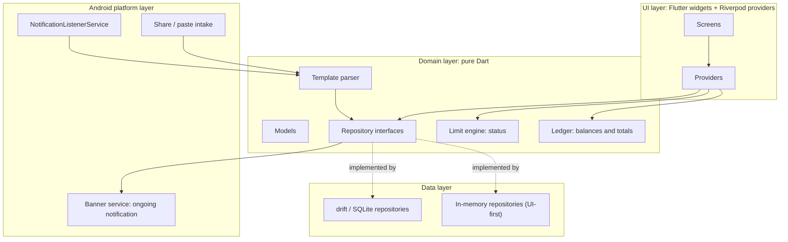
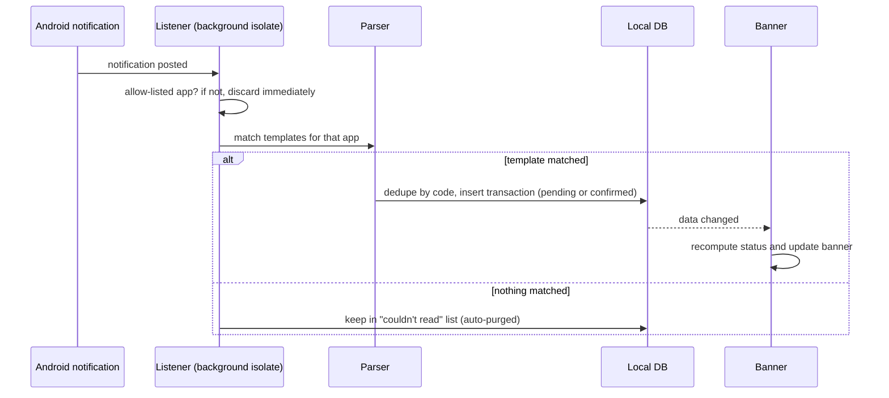
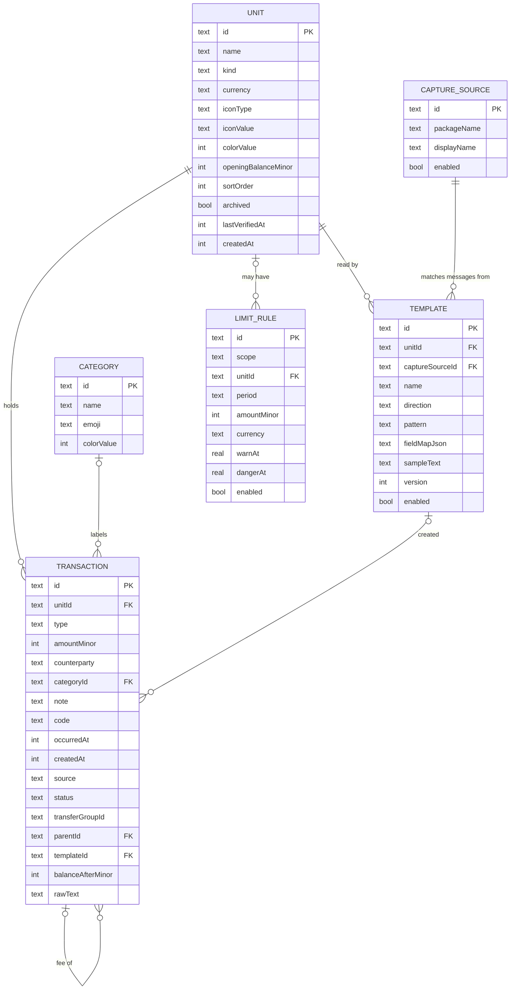

# Design: Fuata

**Version:** 0.1 · **Status:** Draft · **Related:** [requirements](requirements.md), [UI design brief](ui-design-brief.md)

This document records how Fuata is structured and why. It is deliberately short: diagrams first, then decision records (ADRs) for choices that would be costly to reverse.

## 1. Architecture

Three layers plus a thin Android platform layer. The **domain** layer is pure Dart (no Flutter imports) so the ledger, limit engine and parser can be unit-tested without a device.

**Folder mapping**

| Folder | Layer | Contents |
|---|---|---|
| `lib/ui/` | UI | `theme/`, `components/`, `screens/`, Riverpod providers |
| `lib/domain/` | Domain | `models/`, `repositories/` (interfaces), ledger, limits, parser |
| `lib/data/` | Data | `mock/` (in-memory), `db/` (drift) |
| `lib/platform/` | Platform | Banner, listener entry point, share intake (added when needed) |

**UI-first approach.** Screens depend only on repository interfaces. Today they run on in-memory mocks; the drift implementations replace them in issue #13 without touching the screens (Riverpod provider overrides).

### Capture flow

The listener runs in a background Flutter engine, separate from the UI isolate. Both open the same SQLite file, so the database must be safe for two isolates (drift isolate mode or WAL). This is the top project risk and gets a time-boxed spike (issue #18); findings are recorded in section 5.

## 2. Data model

Supporting tables (not drawn): `unparsed_capture` (id, receivedAt, sourcePackage, text; auto-purged after 7 days) and `settings` (key/value: name, accent colour, detail level, Home headline and sections, banner options, theme).

### Field rules

| Field | Rule |
|---|---|
| `amountMinor` | **Signed effect on the unit's balance**, integer minor units (e.g. cents). Outflows are negative. |
| `type` | `spent`, `got`, `moved`, `adjustment` |
| `status` | `confirmed` or `pending`. **Pending rows are excluded from balances and limits** until confirmed; Home shows "N waiting to confirm". |
| `source` | `manual`, `shared`, `notification` |
| `transferGroupId` | Two `moved` rows (one negative, one positive) share a group id. Excluded from spending and income totals. |
| `parentId` | A fee is its own `spent` row pointing at the transaction it belongs to, so fees count as spending automatically. |
| `code` | Provider transaction code. Unique per unit when not null (dedupe). |
| `occurredAt` | UTC epoch milliseconds; "today" is computed in the device's local time zone. |
| `balanceAfterMinor` | Balance quoted in a message, used only for reconciliation checks. |
| `rawText` | Original message, **null by default** (privacy); only kept if the user opts in. |
| `LIMIT_RULE.scope` | `overall` or `unit`. Overall limits cover units in the limit's currency only (v0.1 is effectively single-currency). |

### Derived values (never stored)

- **Balance of a unit** = `openingBalanceMinor + SUM(amountMinor)` over its confirmed transactions.
- **Spent in a period** = `-SUM(amountMinor)` where `type = 'spent'` and confirmed.
- **Status** = ratio of spent to limit: below `warnAt` (0.7) Safe; below `dangerAt` (0.9) Warning; below 1.0 Danger; at or above 1.0, or any unit below zero, Overdraft.
- **Periods**: day = local calendar day; week starts Monday; month = calendar month (configurable later).

## 3. Key flows

| Flow | Steps |
|---|---|
| Add manually | UI → repository insert (confirmed) → providers recompute → banner update |
| Move money | One action creates two `moved` rows with the same `transferGroupId` |
| Update a balance | User enters the true balance; app inserts an `adjustment` row for the difference |
| Capture | Section 1 sequence; pending unless auto-accept is on for that template |
| Reconcile | If `balanceAfterMinor` differs from the computed balance, flag the unit and offer an adjustment |

## 4. Decision records

### ADR-001: Local database with drift (SQLite)
- **Context:** Needs relational queries (sums by period, unit, person), reactive UI, migrations, and access from a background isolate.
- **Decision:** drift on SQLite.
- **Why:** typed queries, streams for reactive screens, built-in migrations, isolate support. Key-value stores (Hive) and object stores fit aggregations poorly; raw `sqflite` lacks typed queries and streams.
- **Consequences:** Code generation (`build_runner`); the two-isolate access must be tested early.

### ADR-002: Riverpod for state management
- **Decision:** `flutter_riverpod`.
- **Why:** compile-time safety, easy testing, and provider overrides let the same screens run on mock or drift repositories, which is what UI-first needs.
- **Alternatives:** Bloc (more boilerplate for a solo four-day build), Provider (weaker testing story).

### ADR-003: Money as integer minor units, currency per unit
- **Decision:** All amounts are integers in the currency's minor unit; each unit has a currency code; a small lookup gives the exponent (2 for KES, 0 for JPY, and so on).
- **Why:** floating point causes rounding errors in sums and comparisons.
- **Consequences:** Formatting and parsing go through one helper (`intl`); v0.1 treats overall limits as single-currency.

### ADR-004: Derive balances from the ledger
- **Decision:** Balance = opening + sum of signed transactions; never stored.
- **Why:** edits, deletions and imports can never leave a stale balance.
- **Consequences:** Needs indexes on `(unitId, occurredAt)`; cache only if profiling shows a need (target: smooth at 5,000 rows).

### ADR-005: Transfers as linked pairs; fees as child rows
- **Decision:** Two signed `moved` rows share a `transferGroupId`; a fee is a separate `spent` row with `parentId`.
- **Why:** keeps balance math a plain sum and excludes transfers from spending without special cases; fees automatically count as spending.
- **Consequences:** The UI groups linked rows into one visual item.

### ADR-006: Notification listener over SMS permission
- **Context:** Reading SMS directly is the most reliable capture but is heavily restricted by Google Play policy.
- **Decision:** Use `NotificationListenerService` (special access granted by the user) plus share/paste as a permission-free path; manual entry always works.
- **Consequences:** Only sees what the SMS app shows (may be truncated); sideloaded builds hit Android's "restricted settings" step, so onboarding must explain it; some manufacturers kill background services. Everything not on the user's allow-list is discarded immediately.

### ADR-007: Template-based parsing (user-labeled), not ML
- **Decision:** The user pastes a sample and labels spans; the app generates a regex with typed groups. Multiple templates per unit.
- **Why:** deterministic, fully offline, explainable, unit-testable; users can fix breakages themselves.
- **Consequences:** Templates break when wording changes; unmatched messages go to a "couldn't read this" list that feeds template fixes.

### ADR-008: Banner as an ongoing notification, not a foreground service
- **Decision:** `flutter_local_notifications` ongoing notification, re-posted on each data change; the listener is started by Android itself.
- **Why:** a foreground service is not needed, and newer Android versions limit data-sync foreground services.
- **Consequences:** Users may swipe the banner away on newer Android; re-post on the next event. Colour is limited, so status is shown with emoji, a progress bar and an accent icon.

### ADR-009: Local-only, no INTERNET permission
- **Decision:** No network code, no telemetry, release manifest without `INTERNET`, fonts bundled as assets, Android auto-backup disabled.
- **Consequences:** No crash reporting or sync; export/import by file is the only way data moves. Debug builds still include `INTERNET` for hot reload; only the release manifest is verified (issue #25).

### ADR-010: No database encryption or app lock in v0.1
- **Decision:** Ship v0.1 with an unencrypted SQLite file.
- **Why:** time-boxed to four days; the data never leaves the device and auto-backup is off.
- **Risk accepted:** anyone with a rooted or unlocked device could read the file.
- **Mitigations now:** auto-backup off, amounts hidden in recents, redacted lock-screen banner by default.
- **Planned:** SQLCipher with an Android Keystore key, plus app lock, in v1.1.

## 5. Open items

| Item | Status |
|---|---|
| Listener + DB from a background isolate (issue #18) | Pending: record outcome here |
| Final visual tokens (colours, type scale, radii) | Pending: copy from the implemented theme into a "Visual direction" section |
| Which providers get bundled template presets | Deferred to v1.1 |
