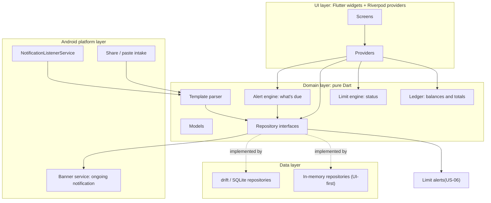
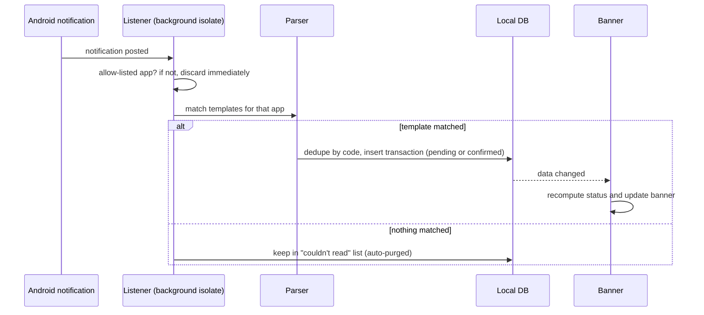
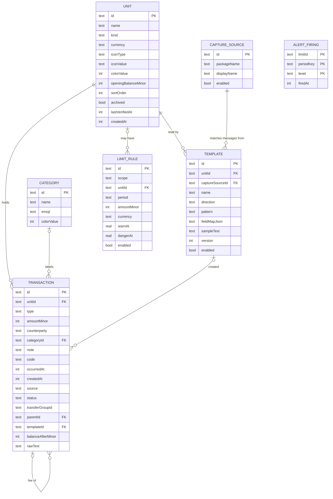

# Design: Fuata

**Version:** 0.1 · **Status:** Draft · **Related:** [requirements](requirements.md), [UI design brief](ui-design-brief.md)

This document records how Fuata is structured and why. It is deliberately short: diagrams first, then decision records (ADRs) for choices that would be costly to reverse.

## 1. Architecture

Three layers plus a thin Android platform layer. The **domain** layer is pure Dart (no Flutter imports) so the ledger, limit engine and parser can be unit-tested without a device.

**Folder mapping**

| Folder | Layer | Contents |
|---|---|---|
| `lib/ui/` | UI | `theme/`, `components/`, `screens/`, Riverpod providers |
| `lib/domain/` | Domain | `models/`, `repositories/` (interfaces), ledger, limits, parser |
| `lib/data/` | Data | `mock/` (in-memory), `db/` (drift) |
| `lib/platform/` | Platform | Banner, listener entry point, share intake (added when needed) |

**UI-first approach.** Screens depend only on repository interfaces. Today they run on in-memory mocks; the drift implementations replace them in issue #13 without touching the screens (Riverpod provider overrides).

### Capture flow

The listener runs in a background Flutter engine, separate from the UI isolate. Both open the same SQLite file, so the database must be safe for two isolates (drift isolate mode or WAL). This is the top project risk and gets a time-boxed spike (issue #18); findings are recorded in section 5.

## 2. Data model

Supporting tables (not drawn): `unparsed_capture` (id, receivedAt,
sourcePackage, text; auto-purged after 7 days), `settings` (key/value:
name, accent colour, detail level, Home headline and sections, banner
options, theme, alert switches, quiet hours), and `alert_firing` (the
log behind "once per threshold per period" — its composite key of
limit id + period key + level is the atomic claim described in §5.4).

### Field rules

| Field | Rule |
|---|---|
| `amountMinor` | **Signed effect on the unit's balance**, integer minor units (e.g. cents). Outflows are negative. |
| `type` | `spent`, `got`, `moved`, `adjustment` |
| `status` | `confirmed` or `pending`. **Pending rows are excluded from balances and limits** until confirmed; Home shows "N waiting to confirm". |
| `source` | `manual`, `shared`, `notification` |
| `transferGroupId` | Two `moved` rows (one negative, one positive) share a group id. Excluded from spending and income totals. |
| `parentId` | A fee is its own `spent` row pointing at the transaction it belongs to, so fees count as spending automatically. |
| `code` | Provider transaction code. Unique per unit when not null (dedupe). |
| `occurredAt` | UTC epoch milliseconds; "today" is computed in the device's local time zone. |
| `balanceAfterMinor` | Balance quoted in a message, used only for reconciliation checks. |
| `rawText` | Original message, **null by default** (privacy); only kept if the user opts in. |
| `LIMIT_RULE.scope` | `overall` or `unit`. Overall limits cover units in the limit's currency only (v0.1 is effectively single-currency). |

### Derived values (never stored)

- **Balance of a unit** = `openingBalanceMinor + SUM(amountMinor)` over its confirmed transactions.
- **Spent in a period** = `-SUM(amountMinor)` where `type = 'spent'` and confirmed.
- **Status** = ratio of spent to limit: below `warnAt` (0.7) Safe; below `dangerAt` (0.9) Warning; below 1.0 Danger; at or above 1.0, or any unit below zero, Overdraft.
- **Periods**: day = local calendar day; week starts Monday; month = calendar month (configurable later).

## 3. Key flows

| Flow | Steps |
|---|---|
| Add manually | UI → repository insert (confirmed) → providers recompute → banner update |
| Move money | One action creates two `moved` rows with the same `transferGroupId` |
| Update a balance | User enters the true balance; app inserts an `adjustment` row for the difference |
| Capture | Section 1 sequence; pending unless auto-accept is on for that template |
| Reconcile | If `balanceAfterMinor` differs from the computed balance, flag the unit and offer an adjustment |

## 4. Decision records

### ADR-001: Local database with drift (SQLite)
- **Context:** Needs relational queries (sums by period, unit, person), reactive UI, migrations, and access from a background isolate.
- **Decision:** drift on SQLite.
- **Why:** typed queries, streams for reactive screens, built-in migrations, isolate support. Key-value stores (Hive) and object stores fit aggregations poorly; raw `sqflite` lacks typed queries and streams.
- **Consequences:** Code generation (`build_runner`); the two-isolate access must be tested early.
- **Implemented (#13):** schema lives in `lib/data/db/tables.dart` — one table per ER-diagram entity, `@DataClassName`-renamed so generated row classes (`UnitRow`, `TransactionRow`, `LimitRuleRow`, ...) don't collide with the domain models of nearly the same name. `AppDatabase` (`lib/data/db/app_database.dart`) opens a single file in app-private storage via a `LazyDatabase`, enforces `PRAGMA foreign_keys = ON`, and starts at `schemaVersion 1` with an `onUpgrade` stub ready for the first real migration. `Drift*Repository` classes (`lib/data/db/drift_repositories.dart`) implement the same four interfaces the mock repos do and are now the default in `app_providers.dart`; screens didn't change. Category, Template, CaptureSource and UnparsedCapture have tables but no repository yet — those land with the features that use them (#19-#22).

### ADR-002: Riverpod for state management
- **Decision:** `flutter_riverpod`.
- **Why:** compile-time safety, easy testing, and provider overrides let the same screens run on mock or drift repositories, which is what UI-first needs.
- **Alternatives:** Bloc (more boilerplate for a solo four-day build), Provider (weaker testing story).

### ADR-003: Money as integer minor units, currency per unit
- **Decision:** All amounts are integers in the currency's minor unit; each unit has a currency code; a small lookup gives the exponent (2 for KES, 0 for JPY, and so on).
- **Why:** floating point causes rounding errors in sums and comparisons.
- **Consequences:** Formatting and parsing go through one helper (`intl`); v0.1 treats overall limits as single-currency.

### ADR-004: Derive balances from the ledger
- **Decision:** Balance = opening + sum of signed transactions; never stored.
- **Why:** edits, deletions and imports can never leave a stale balance.
- **Consequences:** Needs indexes on `(unitId, occurredAt)`; cache only if profiling shows a need (target: smooth at 5,000 rows).

### ADR-005: Transfers as linked pairs; fees as child rows
- **Decision:** Two signed `moved` rows share a `transferGroupId`; a fee is a separate `spent` row with `parentId`.
- **Why:** keeps balance math a plain sum and excludes transfers from spending without special cases; fees automatically count as spending.
- **Consequences:** The UI groups linked rows into one visual item.

### ADR-006: Notification listener over SMS permission
- **Context:** Reading SMS directly is the most reliable capture but is heavily restricted by Google Play policy.
- **Decision:** Use `NotificationListenerService` (special access granted by the user) plus share/paste as a permission-free path; manual entry always works.
- - **Consequences:** Only sees what the SMS app shows (may be truncated); sideloaded builds hit Android's "restricted settings" step, so onboarding must explain it; some manufacturers kill background services (**see §5.1 for a confirmed MIUI case: the listener is granted but not bound unless the grant goes through the UI toggle**). Everything not on the user's allow-list is discarded immediately.

### ADR-007: Template-based parsing (user-labeled), not ML
- **Decision:** The user pastes a sample and labels spans; the app generates a regex with typed groups. Multiple templates per unit.
- **Why:** deterministic, fully offline, explainable, unit-testable; users can fix breakages themselves.
- **Consequences:** Templates break when wording changes; unmatched messages go to a "couldn't read this" list that feeds template fixes.

### ADR-008: Banner as an ongoing notification, not a foreground service
- **Decision:** `flutter_local_notifications` ongoing notification, re-posted on each data change; the listener is started by Android itself.
- **Why:** a foreground service is not needed, and newer Android versions limit data-sync foreground services.
- **Consequences:** Users may swipe the banner away on newer Android; re-post on the next event. Colour is limited, so status is shown with emoji, a progress bar and an accent icon.

### ADR-009: Local-only, no INTERNET permission
- **Decision:** No network code, no telemetry, release manifest without `INTERNET`, fonts bundled as assets, Android auto-backup disabled.
- **Consequences:** No crash reporting or sync; export/import by file is the only way data moves. Debug builds still include `INTERNET` for hot reload; only the release manifest is verified (issue #25).

### ADR-010: No database encryption or app lock in v0.1
- **Decision:** Ship v0.1 with an unencrypted SQLite file.
- **Why:** time-boxed to four days; the data never leaves the device and auto-backup is off.
- **Risk accepted:** anyone with a rooted or unlocked device could read the file.
- **Mitigations now:** auto-backup off, amounts hidden in recents, redacted lock-screen banner by default.
- **Planned:** SQLCipher with an Android Keystore key, plus app lock, in v1.1.

### ADR-011: Backup as one versioned, validated JSON file (issue #24)
- **Decision:** Export/import is a single JSON file (`format: "fuata-backup"`, `formatVersion`), saved and opened through Android's system file window, so Fuata needs no storage permission and never sees a file the person didn't pick. `BackupCodec` (pure Dart) reads and writes it; `ImportPlanner` (pure Dart) decides what an import would do; `DriftBackupRepository` writes it.
- **What's in it:** units, transactions, categories, limits, message rules, watched apps, settings. **Not in it:** balances (derived, ADR-004), unparsed messages (7-day inbox), alert history (derived; a new phone should not be silenced for a period it never showed). Original message text is left out unless the person opts in (ADR-009).
- **Never overwrites silently:** an import is planned first, and nothing is written while previewing. Each record is *new* (added), *identical* (skipped) or *conflicting* (same id, different content). Conflicts are kept as they are on the phone unless the person picks "Use the file's version", which asks once more. Settings are replaced only if the person switches that on (default on only for a phone with no data).
- **All or nothing:** a file with any problem is refused whole, and a valid one is written in one database transaction, parents before children. Records pointing at something found neither in the file nor on the phone block the import instead of reaching a foreign key.
- **Versioning:** `formatVersion` only goes up; a newer file is refused with "update Fuata". Unknown extra keys are ignored, so adding a field doesn't need a version bump.
- **Stable identities:** limits and watched apps are identified by what they are (`LimitRule.idFor`, `CaptureSource.idFor`), so a file with different ids is tidied to match rather than creating a second limit for the same slot.
- **Consequences:** import never deletes (see testing.md, known limitations). The file is unencrypted (ADR-010).

## 5. Open items

| Item | Status |
|---|---|
| Local database and repositories (issue #13) | **Done.** See ADR-001's "Implemented" note. |
| Listener + DB from a background isolate (issue #18) | **Done.** See §5.1 below. |
| JSON export/import (issue #24) | **Implemented; device pass pending (#26).** See ADR-011. |
| Notification listener, allow-list and dedupe (issue #22) | **Implemented; device pass pending (#26).** See §5.2. |
| Final visual tokens (colours, type scale, radii) | Pending: copy from the implemented theme into a "Visual direction" section |
| Which providers get bundled template presets | Deferred to v1.1 |

### 5.1 Spike findings — listener + background isolate (issue #18)

**Question.** Can a background isolate, started by Android when the app is not running, safely open the same `fuata.sqlite` the UI isolate has open and write to it? This was ADR-001's top project risk.

**Answer: yes.** Tested on a Xiaomi/[model], Android [version], MIUI, debug build. Notifications captured reliably across four scenarios — foreground, backgrounded, rapid-fire dispatch, and post-reboot-without-launching-the-app — with no `SQLITE_BUSY`, no `FAILED to write`, and no crashes. `NativeDatabase.createInBackground` is confirmed safe for two isolates on the same file. ADR-001's top risk is closed.

**MIUI-specific prerequisite (recorded for #22).** `cmd notification allow_listener` and direct edits to `Settings.Secure.enabled_notification_listeners` are not sufficient on MIUI — the grant is reported as active, but the system never calls `bindService` and Fuata never appears in `dumpsys notification`'s "Live notification listeners" section. Notifications are silently dropped with no `onNotificationPosted` callback. The listener only binds after toggling the grant **off→on through Settings → Notification access** (the UI path, which goes through `MiuiSecurityCenter`), with Autostart on. Once bound, capture survives backgrounding, rapid-fire dispatch, and reboot — no "open the app after reboot" guidance is needed.

**Known gap for #22 (not a spike failure).** `NotificationListener.kt`'s text extraction writes `sbn.tag` into `raw_text` instead of the notification body on this device. Confirmed against two separate tests. The real listener needs an extras-walk helper that checks `EXTRA_TITLE`, `EXTRA_TEXT`, `EXTRA_BIG_TEXT`, `EXTRA_SUB_TEXT`, `EXTRA_TEXT_LINES` and ticker text in a documented order, and explicitly excludes `sbn.tag`. Filed in #22.

### 5.2 Notification listener, allow-list and dedupe (issue #22)

Replaces the #18 spike (`listener_spike.dart`, the spike `NotificationListener.kt` and the `fuata/listener_spike` channel are gone). What was decided, and why:

**Where the allow-list is enforced: twice.** `capture_sources` (design §2) is the source of truth; enabled rows are the allow-list. Dart mirrors the enabled package names into native `SharedPreferences` on every app start and every change, and `NotificationListener.kt` checks that copy *first* — a notification from any other app is dropped before its text is read and before a Flutter engine is started. `CaptureProcessor.captureNotification` then checks the database again, so US-10 ("discarded immediately and never stored") still holds if the native copy is stale. Until Dart has pushed a list, the native default is to discard everything. Turning an app off flips `enabled` rather than deleting the row, because `templates.captureSourceId` references the table.

**One shared pipeline.** The capture logic moved out of the Riverpod `CaptureService` into `lib/domain/logic/capture_pipeline.dart` (`CaptureProcessor`), which depends only on repository interfaces. The UI isolate (share/paste) and the background isolate (notifications) run the same code; `CaptureService` is a thin wrapper. This is also what makes it testable without a device.

**Dedupe.** Unchanged rule (`Dedupe`: code, else unit + signed amount + 2-minute window), now with two additions that only matter once notifications are automatic:
- capture is check-then-insert, so `CaptureProcessor` runs each capture through a `SerialQueue`; the background dispatcher does the same across calls. Without this, an SMS and its push twin arriving together would both read "nothing stored yet" and both insert.
- unparsed captures are deduped on (source package, raw text). Notifications get re-posted, and "Teach me" re-runs capture on text the list already holds; both used to add a copy. **Known remaining gap:** UI isolate and background isolate each have their own queue, so a share and a notification for the same payment landing in the same instant could still both insert. The background isolate is the only automatic writer, so this needs a manual paste at the same moment.

**One engine, not one per notification.** `CaptureEngine.kt` keeps a single headless engine alive while notifications keep arriving (20 s idle teardown, 90 s watchdog) and feeds it in order. The spike started an engine per notification and destroyed it after a fixed 3 s whether or not the write had finished.

**The UI does not hear the background isolate's writes.** Each isolate opens its own drift connection, and drift only re-runs a stream for writes made through the same database instance. So a capture written in the background would not appear in an open Home/Inbox until something else touched the table. Fix: after each write the native side pings the UI engine (`onCapturesChanged`) and `main.dart` calls `markTablesUpdated([transactions, unparsedCaptures])`; the same call runs on `AppLifecycleState.resumed`. When the banner (#16) landed, it was re-posted from the background isolate too — notification_capture.dart calls _refreshBanner right after _captureOne writes. #63 extended that same post-write hook to also call fireDueAlerts, so a limit crossed by a captured notification alerts from the background isolate as well as the UI isolate.

**Text extraction (the §5.1 known gap).** `NotificationText.kt` walks `EXTRA_BIG_TEXT`, `EXTRA_TEXT`, `EXTRA_TEXT_LINES`, `EXTRA_SUB_TEXT`, `tickerText`, then `EXTRA_TITLE` as a last resort, first non-blank wins, and never reads `sbn.tag` or `sbn.key`. The title is *not* prepended to the body, so the parser sees what a pasted SMS gives it. **Not yet verified on the MIUI device that showed the original symptom.** Group-summary notifications (`FLAG_GROUP_SUMMARY`) are skipped: they are containers for children posted separately, and reading them only produces unreadable "3 new messages" entries. If a device turns out to post only a summary, this is the line to revisit.

**Picking apps without a broad permission.** The picker lists launchable apps via a launcher-intent `<queries>` entry, not `QUERY_ALL_PACKAGES`. Consequence: an app with no launcher icon cannot be picked; debug builds have an "add by package name" field so `adb shell cmd notification post` (posted as `com.android.shell`) can still be allow-listed for testing.

**Known limitations (not bugs):** the Dart callback handle is only valid for the build that registered it, so after an app *update* capture resumes once the app has been opened once; the access status on the Auto-catch screen is the *grant*, not proof the service is bound (§5.1 — detecting that is #36); a notification that arrives while the app has never been opened since install is dropped.

### 5.3 Banner rendering on MIUI (found during #16)

Two MIUI behaviours that cost an afternoon to chase; recorded here so
#26's device pass and any future banner work start from the answer
rather than re-deriving it.

**Lock-screen display requires IMPORTANCE_DEFAULT.** A notification
channel created at `Importance.low` is treated as "silent" and hidden
from the lock screen entirely on MIUI — regardless of the notification's
own `vis=PUBLIC` flag, and regardless of the per-app lock-screen toggle
being on. The banner channel therefore ships at
`Importance.defaultImportance`; the silence that low used to buy comes
from `onlyAlertOnce` + `playSound: false` + `enableVibration: false` in
`_androidDetails()`, which don't affect lock-screen display.

The Android channel system locks a channel's importance after creation:
raising it in code has no effect on an install that already has the old
channel. v0.1.0 has not shipped, so the current `fuata_banner` id is
created fresh on every install and the fix takes on first launch. If
the LOW-importance version ever reaches a real install before release,
bumping the id (and deleting the old channel) is the only fix — this is
why the id is worth keeping in mind if the channel's importance ever
needs to change again after rollout.

**Small icon must be a monochrome drawable.** `_androidDetails()` sets
`icon: '@mipmap/ic_launcher'` — a full-colour PNG. Android's small
notification icon is meant to be a white-on-transparent silhouette; on
MIUI a colour bitmap is hidden entirely, leaving only the "Fuata" text
visible. The fix is `res/drawable/ic_notification.xml` (white vector)
referenced by bare name; Android then tints it via the existing
`setColor()` per status. **Deferred for v0.1** — the banner is legible
without it, and it's a polish item rather than a correctness bug. See
`docs/github-issues.md` Post-#20 follow-ups for the tracking issue.

### 5.4 Limit alerts (issue #63)

`AlertEngine.due` (pure) decides what is due; `claimDueAlerts` records it in `alert_firings` (primary key = limit + period key + level) *before* `BannerPlatform.showAlert` displays it. The claim, not a read-then-write check, is what keeps the UI isolate and the listener's background isolate from announcing the same crossing twice. Period keys: date (day), Monday's date (week), `yyyy-MM` (month). Rows older than 90 days are purged. `DriftLimitRepository.setLimit`/`deleteLimit` clear a limit's rows when its amount changes or it is removed.

Alerts use `fuata_alerts` (high). Inside quiet hours they use `fuata_alerts_quiet` (low, no sound), because per-notification sound overrides are ignored on Android 8+. Notification id is derived from the limit id, so a later level replaces an earlier one. Not done: the banner/Home status ignores per-unit limits; there is no alert when a period ends.
MockAlertLogRepository in data/mock/ mirrors the same contract in memory for widget tests and previews — same "claim once" semantics, no DB.